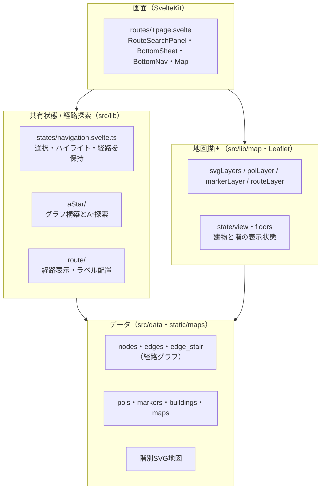
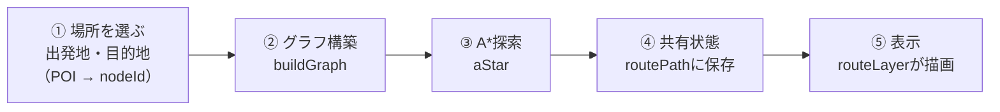
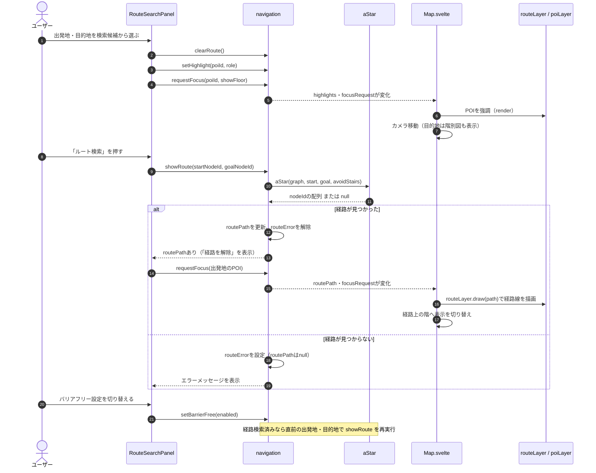
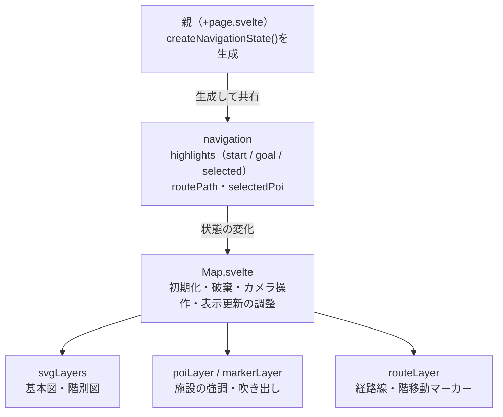

# OMUCT Navi

OMUCT Naviは、校内の教室や施設を探し、目的地までの経路を地図で確認できるナビゲーションアプリです。

## 主な機能

- 校内マップ：建物を選択し、階ごとのフロアマップを確認できます。
- 施設検索：教室や施設を名前・キーワードから検索できます。
- 経路案内：出発地と目的地を選ぶと、経路や建物・階の移動箇所を地図上に表示します。
- バリアフリー検索：階段を使わない経路を検索できます。
- 施設情報：地図上の施設を選択して所在地や登録された説明を確認し、出発地・目的地に設定できます。

## 仕組み

### 全体構成

### 経路探索の流れ

- 通常の辺のコストは2ノード間の直線距離、階段の辺は固定コスト30です。
- バリアフリー設定（`avoidStairs`）では階段の辺を除いて探索します。

### 操作から経路表示までのシーケンス

検索パネルは`navigation`のメソッドだけを呼び、`Map.svelte`は`navigation`の状態変化を受けて描画します。パネルと地図は互いを直接呼びません。

### 状態の所有と更新の流れ

各描画モジュールは互いを直接呼ばず、`Map.svelte`が調整します。詳細は[地図の責務と状態の所有](docs/map_responsibilities.md)を参照してください。

## 使い方

1. 画面下部の検索欄を開き、出発地と行き先を検索します。
2. それぞれ検索候補から場所を選び、「ルート検索」を押します。
3. 地図上の経路を確認します。必要に応じて建物や階を切り替えられます。

バリアフリー設定では、登録された経路情報から階段を除いて検索します。現地の段差や通行状況がすべて反映されているとは限らないため、実際の状況もご確認ください。

## NixOS

NixOSで開発を行なう場合は `steam-run` を `bun dev` の前に入力してください。
